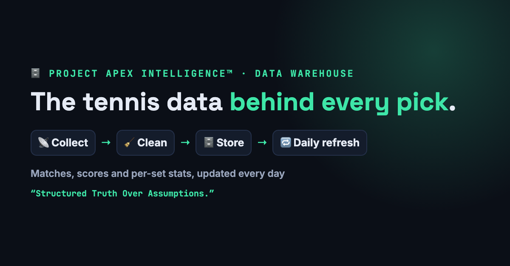

<p align="center"><a href="https://demetriusreynolds251-maker.github.io/apex/"></a></p>
<p align="center"><a href="https://demetriusreynolds251-maker.github.io/apex/"><b>▶ Take the Apex Intelligence™ tour</b></a></p>

# apex-tennis-warehouse

A small standalone collector that keeps a local database of tennis matches, scores and per-set stats current. It runs once a day (`--forward`) and the rest of Apex reads from the database it builds.

> **Note:** Designed and directed by Demetrius Reynolds and built with AI coding assistants. I understand the code and architecture but am not a professional software engineer.

## The Apex system

Apex is a personal hobby project that prices player props (PrizePicks / ParlayPlay style "more or less" lines) by comparing a model probability with sportsbook prices, then posts ranked boards and results to private Discord channels. It is split into these repos:

| Repo | Role |
|---|---|
| `apex-tennis` | Live tennis system: scheduler, model, boards, grading, Discord bot, dashboard |
| `apex-tennis-warehouse` | Collector that keeps the tennis match/stats database up to date |
| `apex-tennis-research` | Backtests, audits and write-ups behind the tennis rules |
| `apex-multisport` | Same idea for other sports (NBA, NFL, NHL, soccer and more), separate from tennis |

Nothing here places bets. It is research and alerting only.

## What is in here

| File | What it does |
|---|---|
| `tennis_warehouse_collector.py` | Entry point. Pulls finished and upcoming matches and writes them to the warehouse |
| `openclaw_v8_api.py` | Client for the SportsAPI365 tennis endpoints (fixtures, stats, players) |
| `apex_price_feed.py` | Match-odds feed from the same provider |
| `apex_sa365_guard.py` | Rate-limit and outage guard so a bad key or a 401 does not hammer the API |
| `deploy/com.apex.tenniswarehouse.plist` | The macOS launchd job that runs it daily |

Four files, about 3,300 lines of Python.

## Tech

Python 3.9+, `requests`, SQLite, SportsAPI365 via RapidAPI.

## Running it (placeholders)

```bash
pip install -r requirements.txt
echo "your-sportapi365-key" > sportapi365_key.txt   # ignored by git
python3 tennis_warehouse_collector.py --forward
```

## License

[Apex Share-Back License 1.1](LICENSE): free to use, study and build on for non-commercial purposes. If you use it, you agree to share your findings and improvements back publicly and for free and credit "Based on Apex by Demetrius Reynolds". Selling it or using it in a paid product needs a written commercial license: [ask on LinkedIn](https://www.linkedin.com/in/demetrius-reynolds/). See the [terms on the site](https://demetriusreynolds251-maker.github.io/apex/#share).
